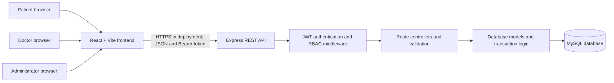

# Software Architecture Document

**System:** Hospital Management System (HMS)
**Revision:** Implementation-aligned update, November 2026
**Status:** Current editable architecture description

This revision updates the architecture represented by [`SAD_SE.pdf`](./SAD_SE.pdf) to match the code in this repository. The PDF remains the original submitted artifact; this document is the current implementation-aligned SAD.

## 1. Scope and architecture

HMS is a browser-based, three-tier application. The React single-page application calls a REST API hosted by the Express backend. The backend authenticates requests, enforces role and resource-level permissions, applies business rules, and reads or writes the MySQL database.



## 2. Component responsibilities

| Component | Responsibility |
|---|---|
| Frontend (`frontend/src`) | React UI for patient, doctor, and administrator workspaces; route guards for role-specific pages; sends JSON requests and the stored bearer token through `services/api.js`. |
| API (`backend/app.js`) | Express application, JSON parsing, security headers, CORS origin restriction, API route mounting, and centralized error responses. |
| Route and validation layer (`backend/routes`, `backend/middleware`) | Declares endpoint methods, validates request parameters and bodies, authenticates bearer tokens, and enforces allowed roles. |
| Controllers (`backend/controllers`) | Implements request-level use cases, ownership checks, response status codes, and explicit database error handling. |
| Models (`backend/models`) | Encapsulates database lookups and shared domain relationships. Appointment creation, rescheduling, and cancellation use transactions and row locks. |
| Database (`database/schema.sql`) | MySQL persistence for users, patient and doctor profiles, appointments, medical records, availability, and audit events. Foreign keys, unique keys, and checks preserve relational and scheduling integrity. |

## 3. Backend API and data flow

The frontend API base is `VITE_API_URL` (default `http://localhost:3000/api`). The backend exposes `/api/auth`, `/api/patients`, `/api/doctors`, `/api/appointments`, `/api/records`, and `/api/admin`.

For a protected call, the frontend sends `Authorization: Bearer <JWT>` and JSON. `authenticate` verifies the token and checks the current user role and active status in the database. Route-level authorization rejects disallowed roles before the controller performs the operation. Controllers use parameterized SQL through the database pool; the API returns JSON and appropriate `4xx` or `5xx` responses.

Key interactions:

- Patients manage their own profile and appointments.
- Doctors manage their own availability and may access patient information only when an appointment links them to that patient.
- Administrators can list and manage user accounts and hospital appointments, and inspect administrative audit events.
- Medical records are linked to an appointment, patient, and doctor. A doctor must have the relevant appointment relationship to create or update a patient's record.

## 4. Authentication and authorization

Login and registration are handled by `/api/auth`. A successful login returns a signed JWT and the user's role. The frontend stores the token for subsequent API calls. For every protected request, backend middleware verifies the signature, reloads the account, and rejects inactive users or tokens whose role no longer matches the database.

Authorization is enforced by backend middleware and controller checks; frontend route guards are for navigation and are not security boundaries.

| Role | Access rules |
|---|---|
| Patient | Read and update own patient profile; book and manage own appointments; read own medical records. |
| Doctor | Manage own availability; view appointments assigned to them; view patient profiles and records only when an appointment establishes the relationship. |
| Administrator | Manage permitted patient/doctor accounts, activate or deactivate other accounts, view and cancel scheduled appointments, and read audit logs. Administrators cannot deactivate their own account. |

All roles require an active account. Patient profile updates are not available to doctors or administrators.

## 5. Sequence: appointment booking

```mermaid
sequenceDiagram
    actor Patient
    participant UI as React frontend
    participant API as Express API
    participant Auth as Authentication middleware
    participant Controller as Appointment controller
    participant DB as MySQL

    Patient->>UI: Select doctor, date, and available time
    UI->>API: POST /api/appointments + Bearer JWT
    API->>Auth: Verify signature, active status, and role
    Auth-->>API: Authenticated patient
    API->>Controller: Validate booking request
    Controller->>DB: Begin transaction; lock doctor and patient
    Controller->>DB: Check availability and conflicting appointments
    alt Slot available
        Controller->>DB: Insert appointment and commit
        DB-->>Controller: Persisted appointment
        Controller-->>UI: 201 Created with appointment
        UI-->>Patient: Show booking confirmation
    else Invalid or unavailable slot
        Controller->>DB: Roll back transaction
        Controller-->>UI: 400 or 409 error response
        UI-->>Patient: Show actionable error
    end
```

## 6. Reliability and security considerations

- Appointment operations use InnoDB transactions, locks, and schema constraints to prevent conflicting active bookings.
- SQL values are passed as parameters rather than interpolated from request input.
- Profile visibility and administrative access are checked on the server for each request.
- The backend limits JSON request size and configures security headers and allowed frontend origins.
- Automated backend tests cover endpoint behavior, authorization, schema integrity, and transaction failure paths. GitHub Actions runs backend checks and the frontend production build for pull requests.

## 7. Source map

- Application composition: [`backend/app.js`](../../backend/app.js)
- Authentication and role checks: [`backend/middleware/authMiddleware.js`](../../backend/middleware/authMiddleware.js)
- Frontend routing and route guards: [`frontend/src/App.jsx`](../../frontend/src/App.jsx)
- Database schema: [`database/schema.sql`](../../database/schema.sql)
